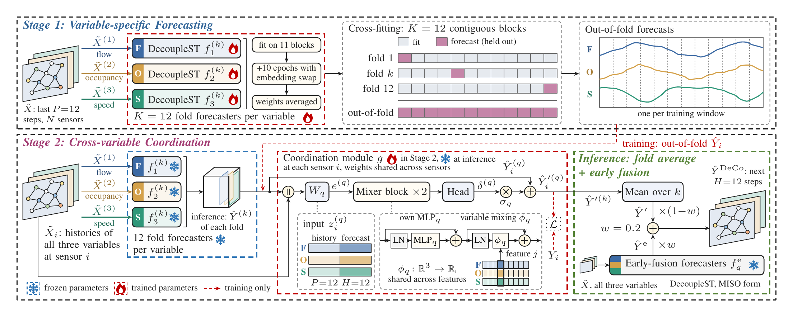
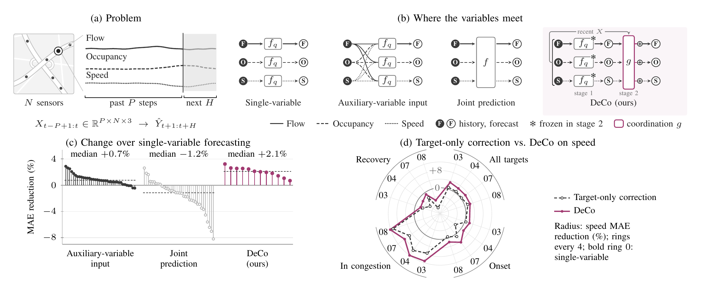

<div align="center">

# DeCo

### Decoupled Traffic State Modeling with Cross-Variable Coordination

[](#citation)
[](https://github.com/lixus7/DeCo/releases/tag/data-v1)
[](requirements.txt)
[](requirements.txt)
[](LICENSE)

**[Overview](#overview)** · **[Main results](#main-results)** · **[Quick start](#quick-start)** · **[Reproducing the paper](#reproducing-the-paper)** · **[Data](#data)** · **[Citation](#citation)**

</div>

## Overview

Flow, occupancy and speed describe the same traffic from different sides, yet forecasting them jointly in one model raises the error in most settings, while reading the other variables as extra inputs helps in most settings. DeCo keeps one forecaster per variable and learns the cross-variable part separately: a small **coordination module** reads the recent histories and the forecasts of all three variables at a sensor and corrects each forecast. The module is trained on out-of-fold forecasts while the forecasters stay fixed; at inference it corrects the forecasts of all twelve fold forecasters per variable, the corrected forecasts are averaged, and the average is blended with an early-fusion forecaster at a fixed weight of 0.2.

<p align="center">
  
</p>
<p align="center"><em>Overview of DeCo.</em></p>

**Contributions**

- **DeCo, a decoupled forecaster with cross-variable coordination.** Dedicated forecasters per variable plus a separately trained coordination module that uses both observed histories and predicted trajectories. With the same forecasters, removing the module raises the error on every dataset and variable (Fig. 4(a)).
- **Three-variable PeMS03 and PeMS07.** The flow-only PeMS03 and PeMS07 benchmarks are aligned with occupancy and speed from the Caltrans PeMS station records, keeping their sensor sets and flow records. Where PeMS reports flow, it matches the benchmark flow in 99.956% of the PeMS03 entries and in every PeMS07 entry. The arrays, validity masks, station identifiers and source checksums are in the [`data-v1` release](https://github.com/lixus7/DeCo/releases/tag/data-v1).
- **A controlled comparison of input and output forms.** STAEformer, HimNet and D²STGNN are trained in the single-variable (SISO, 1→1), auxiliary-input (MISO, 3→1) and joint-output (MIMO, 3→3) forms on all four benchmarks under one protocol. Auxiliary inputs lower the MAE in most settings, by up to 2.9%, whereas joint prediction raises it in most settings, by up to 8.2% (Table III and Fig. 1(c)). The comparison separates cross-variable coordination from target-only correction and forecast averaging (Fig. 4).

<p align="center">
  
</p>
<p align="center"><em>(a) Problem. (b) Where the variables meet. (c) MAE reduction over the corresponding single-variable forecaster; dashed lines mark medians. (d) Speed MAE reduction by traffic state on each dataset. Panels (c) and (d) use DeCo with one forecaster per variable (DeCo-S). Fig. 1 of the paper.</em></p>

## Main results

Test MAE, mean over three seeds, against the best baseline in each column (STAEformer, HimNet and D²STGNN in three forms, RAGC and DecoupleST in the MISO form). Occupancy in %. The full comparison with standard deviations and RMSE is Table III, in [`results/main/`](results/main/).

| Dataset | Variable | Best baseline | DeCo | MAE reduction |
|---|---|---|---|---|
| PeMS03 | Flow | 14.56 (RAGC) | **14.06** | 3.4% |
| | Occupancy | 0.888 (RAGC) | **0.875** | 1.4% |
| | Speed | 1.798 (RAGC) | **1.791** | 0.4% |
| PeMS04 | Flow | 18.95 (DecoupleST MISO) | **18.34** | 3.2% |
| | Occupancy | 0.736 (DecoupleST MISO) | **0.709** | 3.8% |
| | Speed | 1.529 (RAGC) | **1.491** | 2.5% |
| PeMS07 | Flow | 20.21 (DecoupleST MISO) | **19.36** | 4.2% |
| | Occupancy | 1.114 (RAGC) | **1.077** | 3.3% |
| | Speed | 2.100 (RAGC) | **2.021** | 3.8% |
| PeMS08 | Flow | 14.18 (STAEformer SISO) | **13.86** | 2.3% |
| | Occupancy | 0.638 (RAGC) | **0.614** | 3.6% |
| | Speed | 1.238 (RAGC) | **1.218** | 1.6% |

- Removing the coordination module raises DeCo's MAE on every dataset and variable, by 1.35% on average (Fig. 4(a) and Section V-C, [`results/ablation/`](results/ablation/)).
- With one forecaster per variable, coordination lowers the speed MAE within congestion by 8.2–12.2% relative to the single forecasters, against 5.5–10.9% for target-only correction (Fig. 1(d) and Section V-F, [`results/states/`](results/states/)).
- A network-wide forecast of all three variables takes 61 ms on PeMS04 at batch size one on one H100 (Section V-H, [`results/cost/`](results/cost/)).

The tables behind every result of the paper, with per-seed values, are described in [`results/README.md`](results/README.md).

## Quick start

```bash
git clone https://github.com/lixus7/DeCo.git
cd DeCo
pip install -r requirements.txt     # Python 3.11
python tests/smoke_cpu.py           # every stage on synthetic data, a few minutes on CPU
```

Then get the data (next section) and run one dataset and seed:

```bash
python run.py prepare --dataset pems08
python run.py pipeline --dataset pems08 --seed 2024
```

The baseline models are not redistributed; `third_party/README.md` lists the repositories and commits used in the paper.

## Data

| Dataset | Sensors | Steps (5 min) | Period | Source of the three variables |
|---|---|---|---|---|
| PeMS03 | 358 | 26,208 | 2018-09-01 to 2018-11-30 | flow from the benchmark; occupancy and speed aligned from PeMS ([`data-v1`](https://github.com/lixus7/DeCo/releases/tag/data-v1)) |
| PeMS04 | 307 | 16,992 | 2018-01-01 to 2018-02-28 | three-variable release of ASTGCN |
| PeMS07 | 883 | 28,224 | 2017-05-01 to 2017-08-06 | flow from the benchmark; occupancy and speed aligned from PeMS ([`data-v1`](https://github.com/lixus7/DeCo/releases/tag/data-v1)) |
| PeMS08 | 170 | 17,856 | 2016-07-01 to 2016-08-31 | three-variable release of ASTGCN |

[`data/README.md`](data/README.md) shows how to download the PeMS03 and PeMS07 arrays, how to build PeMS04 and PeMS08, how the arrays were made, and their checksums. Each split is chronological, 6:2:2.

## Reproducing the paper

For one dataset and seed, `pipeline` runs every step in sequence (skipping completed ones) and writes each task to `results/<task id>/`:

```bash
python run.py prepare --dataset pems08
python run.py pipeline --dataset pems08 --seed 2024
```

The DeCo forecast and its test metrics are in `results/deco-pems08-2024/` (`test_prediction.npy`, `COMPLETE.json`). The paper reports the mean and standard deviation over seeds 2024, 2025 and 2026. The same run also trains DeCo-S and the target-only module (`results/eval-a12-pems08-bank2024-s2024-coord/` and `...-target_only/`, FINAL deployment); `--ablation` adds the two input-zeroing arms of Fig. 4(b).

On a cluster, schedule the steps yourself. Per dataset and seed (`--variable` is `flow`, `occupancy` or `speed`, `--fold` 0–11):

```bash
# 1. First phase: 12 fold forecasters and one final forecaster per variable, and one early-fusion (MISO) forecaster per variable
python run.py forecaster --dataset pems08 --seed 2024 --variable flow --fold 0
python run.py forecaster --dataset pems08 --seed 2024 --variable flow
python run.py forecaster --dataset pems08 --seed 2024 --variable flow --architecture decouplest_miso
# 2. Second training phase of each of these 42 forecasters
python run.py continue --dataset pems08 --seed 2024 --variable flow --fold 0
python run.py continue --dataset pems08 --seed 2024 --variable flow
python run.py continue --dataset pems08 --seed 2024 --variable flow --architecture decouplest_miso
# 3. Bank of the second-phase forecasts, DeCo's module, its fold-average deployment, and the blend
python run.py bank --dataset pems08 --seed 2024 --phase 2
python run.py module --dataset pems08 --seed 2024 --phase 2 --arm coord_nonode
python run.py evaluate --dataset pems08 --seed 2024 --phase 2 --arm coord_nonode
python run.py blend --dataset pems08 --seed 2024
```

Variants and analyses:

```bash
# DeCo-S and the target-only module (first-phase bank, FINAL deployment)
python run.py bank --dataset pems08 --seed 2024
python run.py module --dataset pems08 --seed 2024 --arm coord
python run.py evaluate --dataset pems08 --seed 2024 --arm coord
python run.py module --dataset pems08 --seed 2024 --arm target_only
python run.py evaluate --dataset pems08 --seed 2024 --arm target_only
# Input zeroing of Fig. 4(b): the other variables' histories or forecasts set to zero
python run.py module --dataset pems08 --seed 2024 --arm coord_no_hist
python run.py module --dataset pems08 --seed 2024 --arm coord_no_fc
# Traffic states of Section V-F at level S2 (after DeCo-S and the target-only module for all three seeds)
python run.py states --dataset pems08 --levels S2
python run.py thresholds --dataset pems08
# Baselines
python run.py forecaster --dataset pems08 --seed 2024 --variable speed --architecture ragc
python run.py baseline --dataset pems08 --seed 2024 --architecture staeformer --variant miso_speed
```

| Name in the paper | Module arm | Bank (`--phase`) | Deployment |
|---|---|---|---|
| DeCo | `coord_nonode` | 2 (second-phase forecasters) | K12 (fold average), then `blend` |
| DeCo-S | `coord` | 1 (first-phase forecasters) | FINAL (one forecaster per variable) |
| Target-only module | `target_only` | 1 | FINAL |
| w/o other variables' histories / forecasts | `coord_no_hist` / `coord_no_fc` | 1 | FINAL |

The reported DeCo fits ran on NVIDIA H100 GPUs. Most of the training time is in the 36 fold forecasters, which are independent and can run in parallel; per-seed values are in `results/cost/`.


<details>
<summary><b>Repository layout</b></summary>

| Path | Content |
|---|---|
| `run.py` | Command-line entry for every stage |
| `deco/decouplest.py` | DecoupleST forecaster |
| `deco/train.py` | First training phase of every forecaster and baseline (at most 200 epochs, patience 30) |
| `deco/second_phase.py` | Second training phase: ten epochs with embedding swap, weights averaged |
| `deco/fold_inputs.py`, `deco/prepare.py` | Twelve-fold partitions and fold-local causal inputs |
| `deco/banks.py` | Out-of-fold, fold and final forecasts of one phase in one bank |
| `deco/module.py` | Coordination module, target-only module, the variant without sensor embedding and the input-zeroing views |
| `deco/module_train.py`, `deco/module_data.py`, `deco/selection.py` | Module training, checkpoint selection on validation, and the fold-average (K12) and single-forecaster (FINAL) deployments |
| `deco/blend.py` | DeCo's output: fold average of the corrected forecasts blended with the early-fusion forecasts |
| `deco/evaluation.py`, `deco/states.py` | Metrics with validity masks, traffic states, congestion thresholds and day-block comparisons |
| `deco/models.py`, `deco/external_models.py` | DecoupleST MISO, RAGC, the module arms and the baseline wrappers |
| `configs/` | Dataset settings, congestion thresholds and baseline source commits |
| `data/` | Data layout, checksums and provenance; the arrays are in the `data-v1` release |
| `results/` | Results behind Tables III–V, Fig. 4 and the traffic-state and cost analyses (Sections V-F and V-H) of the paper, with per-seed values |
| `assets/` | Figures of this page, rendered from the paper's sources |
| `tests/smoke_cpu.py` | End-to-end check of every stage on synthetic data |

</details>

<details>
<summary><b>Implementation details</b></summary>

These details complete Sections IV and V of the paper.

**DecoupleST.** The input packet has four history slots, and the experiments fill the recent window (history-availability vector (1, 0, 0, 0)). Each head maps 4×12×64 = 3072 features through 128 hidden units to 12 steps, and the direct map takes the 48 history entries to 12 steps. The adjacency is A = softmax(ReLU(E1 E2ᵀ)) with the diagonal excluded, E1, E2 ∈ R^{N×16}.

**Coordination module.** Each variable's encoder reads 60 entries: 12 history steps, 36 zeros for the unused daily and weekly slots, and 12 forecast steps. φ_q has 16 hidden units; the activations are GELU; the LayerNorm affine parameters are shared across variables. DeCo's module omits the sensor embedding s_i (`coord_nonode`); DeCo-S keeps it (`coord`). Without the embedding, the module uses 0.11 million parameters.

**Cross-fitting.** Three precautions keep the held-out targets out of each fold fit: training windows that overlap the held-out target times are dropped; the inner validation set is the last 10% of the remaining windows, with its own overlap rule; and the input filling is causal and recomputed after masking the held-out targets (and, for training inputs, the inner-validation targets). Fold scalers use only the permitted times. Each fold forecaster keeps 82.1–82.4% of the training windows of the final forecaster.

**Training recipe.** First phase (all models of Table III): MAE over valid nonzero targets in standardized units, Adam with learning rate 1e-3 and weight decay 1e-4, no learning-rate schedule, gradient clipping at 5, effective batch size 16, at most 200 epochs, early stopping on validation MAE with patience 30. Module: AdamW with learning rate 5e-4 and weight decay 1e-4, mini-batches of 512 origin–sensor pairs.

**Second training phase.** Ten epochs from the selected checkpoint with the first phase's optimizer settings (fresh Adam state). At every step, each sensor's rows of the sensor-embedding table and of E1, E2 are replaced, together, by those of a randomly drawn sensor with probability 0.1 (RAGC's embedding swap). The weights are averaged over the ten epochs with equal weights. This applies to the fold, final and early-fusion forecasters.

**Module selection.** The validation score is the MAE over valid nonzero targets in standardized units, averaged over the variables. After every epoch, both deployments are scored (the fold average and the one final forecaster per variable, the reference forecaster of Section V-A); the uncorrected forecasts (epoch 0) are the first candidate. An epoch counts as an improvement only if it lowers a score by more than 1e-8. Training stops when neither score has improved for eight epochs, or after 25 update epochs. DeCo keeps the best checkpoint under the fold-average score, DeCo-S the best under the single-forecaster score.

**Baselines.** STAEformer has 3 layers and 4 heads; HimNet has hidden size 64 and time embeddings of size 8; D²STGNN has 5 layers of width 32 and embeddings of size 12. RAGC uses its official implementation with 288 steps per day, three inputs and one output. DecoupleST MISO shares its initial weights and batch order with the SISO forecasters. Further-baseline exceptions: DeepAR uses the Gaussian NLL; GTS, HyperD and DSFormer keep their auxiliary losses; AutoSTL keeps its bounded architecture search; DMSTGCN and MVC-STNet use batch size 64; LightGBM uses the L1 objective with up to 1,000 rounds.

**Statistics.** A test window belongs to the day of its first forecast step. The intervals resample these days (10,000 draws shared across methods and seeds) and average the seed-level MAEs within each resample.

**Traffic states.** A sensor is congested at a step when its speed is at most, and its occupancy at least, a threshold set from the training targets of its dataset, pooled over sensors (`configs/datasets.json`, `python run.py thresholds`). The paper's level S2 uses the 5th percentile of speed and the 95th of occupancy. The looser levels of Fig. 7 are S1 (20th / 80th) and the original definition (35th / 65th), for which PeMS04 keeps its earlier constants, 63.9 mph and 5.98%. Under the original definition, onset and recovery each hold 3.5–4.7% of the valid speed targets, and in the net reduction in speed error obtained by coordinating with all variables rather than the target alone (DeCo-S against the target-only module), onset accounts for 1.8–9.6 times and recovery for 3.5–7.8 times its share of targets; at S2, onset holds 1.0–1.2% of the speed targets and accounts for 5.0–25.5 times that share.

**Cost measurement.** Latency was measured in float32 with TF32 disabled (PyTorch 2.4.1, CUDA 12.1) on one NVIDIA H100: ten warm-up calls, then the median of 100 synchronized calls, from GPU-resident inputs through normalization, the forecasters, the correction, the fold averaging and the blend. Training hours sum the epoch wall times of the accepted fits, including validation and data access.

**Data.** The alignment of PeMS03 and PeMS07, including how the PeMS07 nodes were matched to stations, is described in [`data/README.md`](data/README.md).

</details>

<details>
<summary><b>Provenance and checks</b></summary>

This repository consolidates implementations from the experiment packages used for the reported runs, with cluster scheduling and internal bookkeeping removed. The coordination modules of PeMS04 and PeMS08 were fitted and selected on float32 labels, which this code keeps for these two datasets (`module_labels` in `configs/datasets.json`); metrics read the float64 arrays. The second training phase, the module without sensor embedding, the blend, the input zeroing and the traffic-state analysis were run as separate packages and are merged into this code.

We checked the consolidated code against the experiment code: the initial weights, outputs and gradients of the DecoupleST forecaster classes and coordination-module variants, the ten-epoch second-phase loops and the bank assembly on synthetic data, and, on the real data, the congestion thresholds, the per-seed test metrics of DeCo and the traffic-state results recomputed from the saved forecasts. Device selection was generalized so that the code also runs on CPU; the reported results were produced on GPUs, and the embedding-swap draws differ between CPU and GPU.

</details>

## Citation

The paper is under review at ICDE 2027; a BibTeX entry will be added here once it is published. Until then, please cite this repository if you use the code or the aligned PeMS03 and PeMS07 arrays.

## Acknowledgements

Occupancy and speed of PeMS03 and PeMS07 come from the [Caltrans PeMS](https://pems.dot.ca.gov) data clearinghouse. Flow and graphs come from the benchmark releases of [STSGCN](https://github.com/Davidham3/STSGCN), [ASTGNN](https://github.com/guoshnBJTU/ASTGNN) and [ASTGCN](https://github.com/Davidham3/ASTGCN-2019-mxnet). The baselines use the code of [STAEformer](https://github.com/XDZhelheim/STAEformer), [HimNet](https://github.com/XDZhelheim/HimNet), [D²STGNN in BasicTS](https://github.com/GestaltCogTeam/BasicTS) and [RAGC](https://github.com/wkq-wukaiqi/RAGC). We thank their authors.

## License

The code and the result tables are under the [MIT License](LICENSE). The license does not cover the data, whose sources are listed in [`data/README.md`](data/README.md), or the baseline code, which is not redistributed here.
